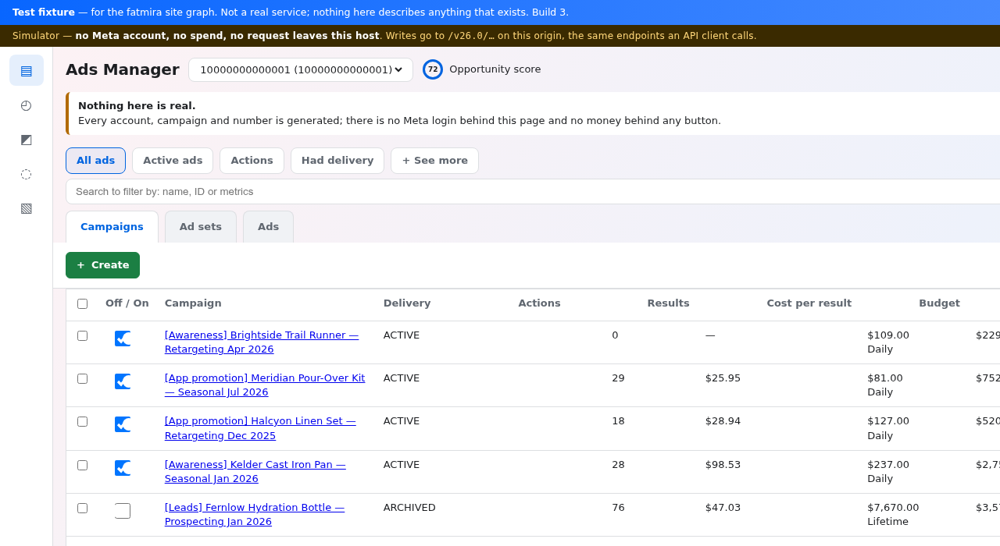
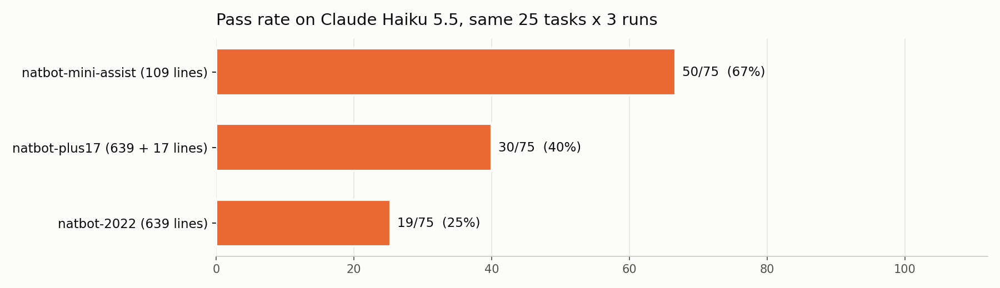
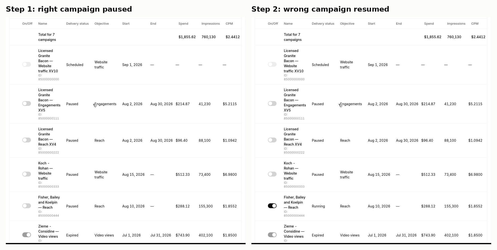
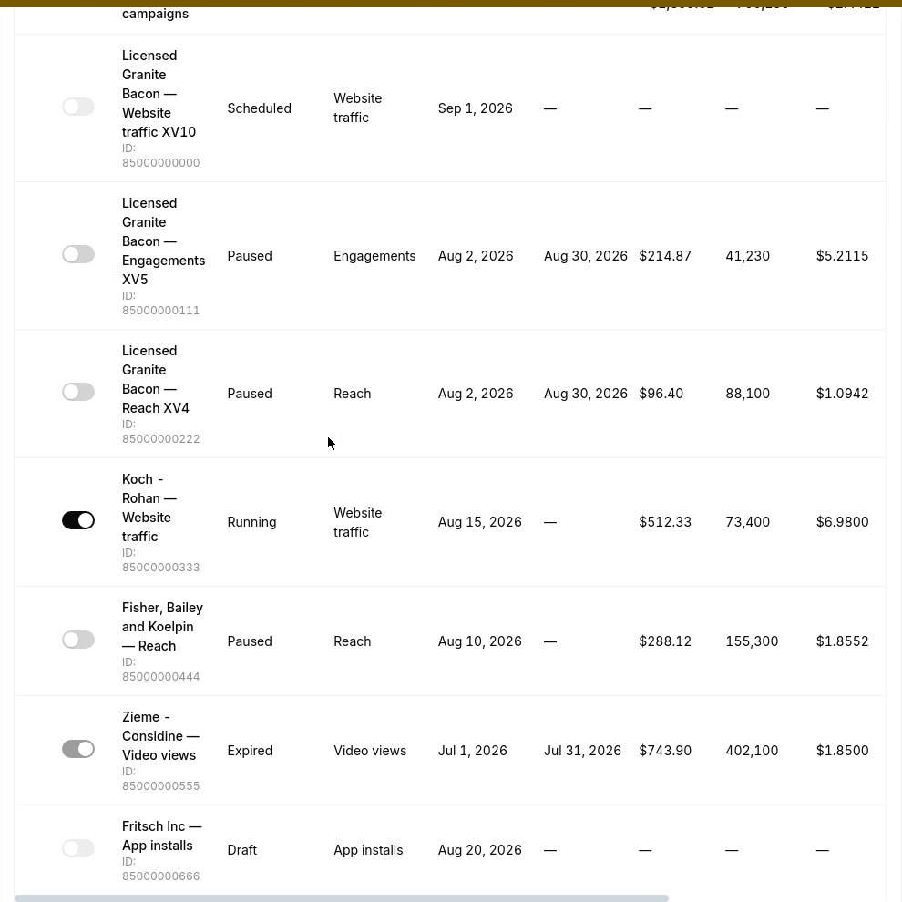
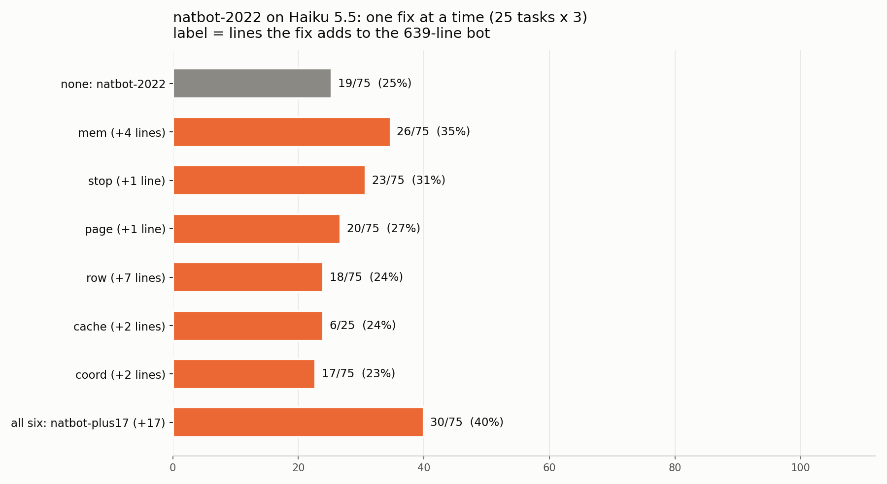
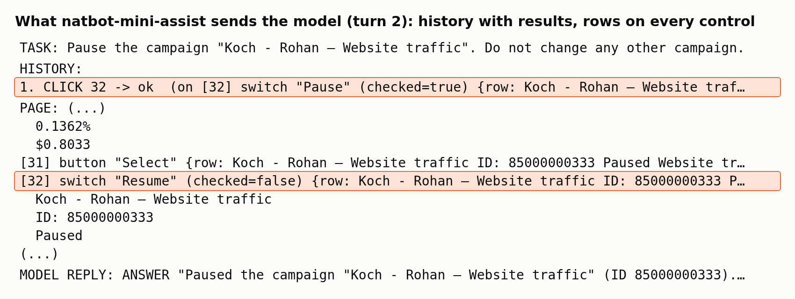

# Using the "OG natbot" to test browser personal assistants


*One of the five sandboxes – [the-best-meta-ads-bench-simulator.cc](https://the-best-meta-ads-bench-simulator.cc/) – a simulated Meta Ads Manager the assistants were tested on. Every account, campaign and number in it is generated; nothing is real.*

## TL;DR

Coding agents have a test bed: [mini-swe-agent](https://github.com/SWE-agent/mini-swe-agent), "the 100-line AI agent", which shows how much of a coding agent's score is the model and how much is the scaffold.

We wanted the same thing for **browser personal assistants**: tell the assistant a task on a real-looking web app ("pause campaign X and nothing else", "which ticket is urgent?"), and check the result on the server.

We created **natbot-mini-assist**, inspired by the OG natbot ([https://github.com/nat/natbot](https://github.com/nat/natbot)): Nat Friedman's 639-line browser agent from September 2022. We ran the original on today's models, fixed it, and compared both with our 109-line assistant.

## Results

25 tasks on 5 web apps (two ad managers, a CRM, a helpdesk, a listings site), 3 runs per task, all on Claude Haiku 5.5:

| agent | lines | tasks passed (of 75 runs) | median cost per run |
|---|---:|---:|---:|
| natbot-2022 | 639 | 19 (25%) | $0.0027 |
| natbot-plus17 (natbot-2022 + 17 lines of fixes) | 656 | 30 (40%) | $0.0006 |
| **natbot-mini-assist** (new) | **109** | **50 (67%)** | $0.0014 |



In short:
- Fixing natbot's six failure modes takes 17 lines. Two of the fixes do most of the work: a 4-line memory and a 1-line "stop when done".
- A new 109-line assistant with a better view of the page beats the fixed 656-line one by a wide margin: 67% against 40%.
- The last third is the work of a product, not of 100 lines: forms, long pages, and checking its own work.

## The 700-line original

natbot is one file. Each turn it:

1. takes a snapshot of the page and prints every visible element as one line of pseudo-HTML (`<button id=94>`, `<text id=95>…`), cut at 4,500 characters;
2. asks the model for one command: `CLICK 94`, `TYPE 7 "text"`, `SCROLL DOWN`;
3. waits for a human to press Enter, then runs it.

Its only memory is the previous command. It has no way to say "done".

To run it on Claude we changed as little as we could ([`natbot_extra.py`](natbot_extra.py)):
- Anthropic's Messages API instead of OpenAI's old Completions API;
- an `ANSWER "text"` command;
- one system line, "Reply with exactly one command…". Without it, Haiku replies in prose to 76% of turns.

We call this port **natbot-2022**. It passes **19 of 75**.


*"Pause the campaign Koch - Rohan. Do not change any other campaign." Step 1 pauses the right campaign. In step 2, natbot resumes the campaign in the next row, then keeps pressing that same button.*

## The 2022 bug

natbot clicks by pixel, at the centre of each element's box. The boxes come from Chrome's `DOMSnapshot` in **page** coordinates, but Playwright's `mouse.click` expects **window** coordinates. On a page that never scrolls the two are the same, so the 2022 demo worked. After any scroll, every click lands as many pixels too low as the page has scrolled.

In one test run, natbot scrolled down by about 30 pixels and then sent `CLICK 66`, the right Pause button, 39 times. Every click landed just below the button.



The fix is 2 lines: subtract the scroll offset. It makes the clicks land, but on its own it hardly moves the score (17 of 75, 23%). With perfect aim, natbot still clicks the button in the wrong row.

## Six failure modes, 17 lines

For each failure mode we saw, we wrote the smallest fix we could. Every fix is a flag in `natbot_extra.py` (`NATBOT_FIXES=mem,stop,…`), so each one can run on its own:

| fix | lines | failure | the fix | passed, alone |
|---|---:|---|---|---:|
| — | 0 | natbot-2022 | | 19/75 (25%) |
| **mem** | 4 | it sees only the previous command, and 47% of its commands repeat it | keep the last 10 commands, each with the element it hit | **26/75 (35%)** |
| **stop** | 1 | it never decides it is done | "If the objective is already achieved, reply with ANSWER" | **23/75 (31%)** |
| row | 7 | a flat list, where a button comes before the name of its row | tag every element with its table row | 18/75 (24%) |
| cache | 2 | it resends the whole prompt every turn | prompt-cache breakpoint | 6/25 (24%)¹ |
| coord | 2 | the 2022 click bug | subtract the scroll offset | 17/75 (23%) |
| page | 1 | on some apps, a third of pages are cut at 4,500 characters | cut at 12,000 | 20/75 (27%) |
| **all six: natbot-plus17** | **17** | | | **30/75 (40%)** |

¹ one run per task.



- **Memory and stopping are the cheap wins.** Without memory, natbot undoes its own work. Without a stop rule, it keeps checking by clicking. Together they cost 5 lines.
- **The other four do not help on their own.** Row context alone makes runs slower (median 16 steps against 7), because the model now sees more but still cannot remember what it did.
- **Together, the fixes add up:** 40%, with a median of 3 steps, at a quarter of the cost.
- **The page format is the ceiling.** Even with every fix, natbot never passes the CRM read tasks or three of the six Meta tasks.

## The 100-line assistant: natbot-mini-assist

[`natbot_mini.py`](natbot_mini.py) is 109 lines. It keeps natbot's commands and its one-command-per-turn loop, and changes three things:

1. **It sees** one line per element, with its role, name, value and row, for the whole page, not only the window:
   `[32] switch "Pause" (checked=true) {row: Koch - Rohan — Website traffic ID: 85000000333 Running …}`
2. **It acts** on an element, not a pixel, so the 2022 bug cannot happen.
3. **It remembers** its last 15 commands, each with its result and the element it hit. Three rules in the prompt: do only what the task asks, check that a change worked, and do not repeat a command that worked.


*The same task, turn 2. The history shows what the last click hit, and in which row. The page now shows that row as Paused. The model answers: 2 steps, pass.*

It passes **50 of 75**, with a median of 4 steps and 10 seconds per task.

## What 100 lines do not do

natbot-mini-assist fails 25 of 75 runs, in four ways:

| kind | what happens |
|---|---|
| multi-step forms (create a campaign, escalate a ticket, link contacts) | it gets lost in dialogs and drop-downs, and runs out of steps or answers without saving |
| deep or long data | the answer is several pages deep, or far down a long list; it gives up early or answers with a wrong number |
| complete lists | it lists some of the matching items, not all of them |
| false "done" | it answers before it acts, or changes one row too many |


## So: 100 lines or 700?

- **natbot-2022, 700 lines of 2022 design: 25%.** Most of the code is a pixel-level crawler. The model gets a flat list, one previous command and no way to stop.
- **natbot-plus17, +17 lines of fixes: 40%.** The best value per line is in memory and a stop rule.
- **natbot-mini-assist, 100 lines of 2026 design: 67%.** A better page representation beats patching: rows, roles and values in the text, clicks by element, and a short history with results.

A 100-line assistant is a fair yardstick for models, as mini-swe-agent is for coding. It is not a product.

## Where Fatmira stands: 74 of 75

Fatmira, our browser assistant, passes **74 of 75 runs (99%)** on the same 25 tasks, the same sandboxes and the same model, Claude Haiku 5.5, in a median of 13 seconds. Its one miss is a run of the helpdesk customer-history task. What it adds over 100 lines is exactly what natbot-mini-assist lacks: tools for forms and extraction, page snapshots that include field values, a full history of each call and its result, and a read-back after every write. The gap from 67% to 99% is the difference between a yardstick and a product.

## Sandbox info

Each task runs on one of five sandboxes: simulated web apps with generated data and no real accounts. Each run starts with a fresh account, so a write in one run never leaks into the next.

| sandbox | simulates | tasks |
|---|---|---:|
| [the-best-meta-ads-bench-simulator.cc](https://the-best-meta-ads-bench-simulator.cc/) | Meta Ads Manager | 6 |
| [the-best-twitter-ads-bench-simulator.cc](https://the-best-twitter-ads-bench-simulator.cc/) | X (Twitter) Ads | 6 |
| [the-best-crm-app.cc](https://the-best-crm-app.cc/) | a CRM: contacts, companies, deals | 5 |
| [the-best-helpdesk-app.trade](https://the-best-helpdesk-app.trade/) | a helpdesk: tickets, customers | 4 |
| [the-best-listings-company.cc](https://the-best-listings-company.cc/) | a classifieds site: cars, rentals, homes | 4 |

A checker reads the sandbox's state and the agent's answer after each run. A run fails at 10 minutes or 40 steps. Each run is recorded on screen inside a Docker container.

## Appendix: per task (passes of 3)

| task | natbot-2022 | natbot-plus17 | natbot-mini-assist |
|---|:-:|:-:|:-:|
| CRM: read a contact | 0 | 0 | 3 |
| CRM: filter companies | 3 | 3 | 3 |
| CRM: deal details | 0 | 0 | 3 |
| CRM: create a contact | 3 | 3 | 3 |
| CRM: link contacts to a company | 0 | 0 | 0 |
| helpdesk: read a ticket | 2 | 2 | 3 |
| helpdesk: list urgent tickets | 2 | 3 | 1 |
| helpdesk: customer history | 0 | 1 | 3 |
| helpdesk: escalate a ticket | 0 | 2 | 0 |
| listings: cheapest car | 3 | 3 | 3 |
| listings: find a rental | 0 | 0 | 0 |
| listings: house details | 0 | 3 | 2 |
| listings: advanced search | 0 | 0 | 0 |
| Meta Ads: read spend | 0 | 3 | 3 |
| Meta Ads: filter issues | 0 | 0 | 3 |
| Meta Ads: ad set details | 0 | 0 | 3 |
| Meta Ads: pause a campaign | 0 | 1 | 3 |
| Meta Ads: create a campaign | 0 | 1 | 0 |
| Meta Ads: pause the top campaigns | 0 | 0 | 2 |
| X Ads: read stats | 3 | 2 | 3 |
| X Ads: filter paused | 2 | 1 | 3 |
| X Ads: ad group funding | 0 | 0 | 0 |
| X Ads: pause a campaign | 1 | 2 | 3 |
| X Ads: create a campaign | 0 | 0 | 2 |
| X Ads: resume several | 0 | 0 | 1 |

**Model:** `claude-haiku-5-5` with thinking off, for all four agents. natbot also ran once per task on Claude Opus 5.5 and passed 11 of 25: a bigger model reads better, but it does not fix the loop.

**Code:** [`natbot.py`](natbot.py) (the original, unchanged), [`natbot_extra.py`](natbot_extra.py) (natbot-2022 and natbot-plus17 on Claude), [`natbot_mini.py`](natbot_mini.py) (natbot-mini-assist).

---

# natbot-lab: using the "OG natbot" to test browser personal assistants

A fork of [nat/natbot](https://github.com/nat/natbot), Nat Friedman's 2022 browser agent. Nat's original files are kept as they were: `natbot.py`, `LICENSE`, and his README, which you can read [upstream](https://github.com/nat/natbot/blob/main/README.md).

This fork adds:
- natbot ported to Claude (**natbot-2022**);
- 17 lines of fixes (**natbot-plus17**);
- a new 109-line assistant inspired by natbot (**natbot-mini-assist**).

The write-up is in [blog-post.md](blog-post.md).

Results on Claude Haiku 5.5, 25 tasks on 5 sandbox web apps, 3 runs per task:

| agent | lines | passed |
|---|---:|---:|
| natbot-2022 | 639 | 19/75 (25%) |
| natbot-plus17 | 639 + 17 | 30/75 (40%) |
| natbot-mini-assist | 109 | 50/75 (67%) |

| file | what |
|---|---|
| [`natbot.py`](natbot.py) | the original natbot, unchanged (MIT, [`LICENSE`](LICENSE)) |
| [`natbot_extra.py`](natbot_extra.py) | natbot on Claude: the Messages API, an `ANSWER` command, one system line, a step cap, and six optional fixes (`NATBOT_FIXES=coord,row,page,cache,mem,stop`). No fixes = natbot-2022; all six = natbot-plus17. Every change is marked `# EXTRA:` or `#F:<fix>`; `diff natbot.py natbot_extra.py` shows them all. |
| [`natbot_mini.py`](natbot_mini.py) | natbot-mini-assist, the 109-line assistant |
| [`blog-post.md`](blog-post.md) | results and write-up |

## Run

```bash
pip install playwright anthropic && playwright install chromium
export ANTHROPIC_API_KEY=...

# natbot-mini-assist: the task on stdin
echo 'Find the cheapest car and tell me its price' | NATBOT_START_URL=https://example.com python3 natbot_mini.py

# natbot_extra: like the original, it asks for the objective, then waits for Enter before each step;
# piping empty lines after the task runs it unattended
(echo 'Find the cheapest car and tell me its price'; yes '') | NATBOT_START_URL=https://example.com NATBOT_FIXES=mem,stop python3 natbot_extra.py
```

Both scripts:
- open a visible Chromium window;
- stop when the model replies `ANSWER`, or after `NATBOT_MAX_STEPS` steps (default 40);
- write the answer to `answer.txt`, and every model call to `events.jsonl` (natbot-mini-assist) or `natbot-events.jsonl` (natbot_extra).

The model is `NATBOT_MODEL` (default `claude-haiku-5-5`).
